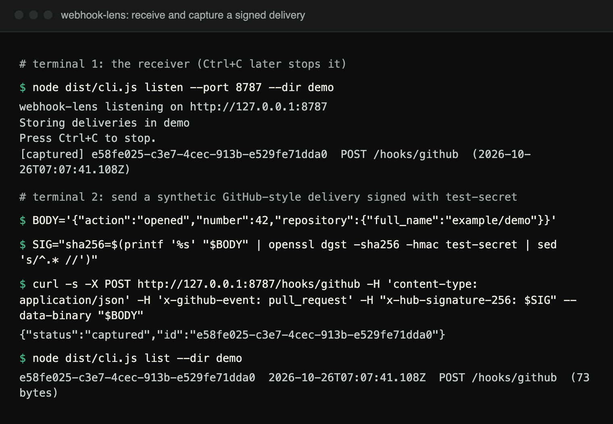
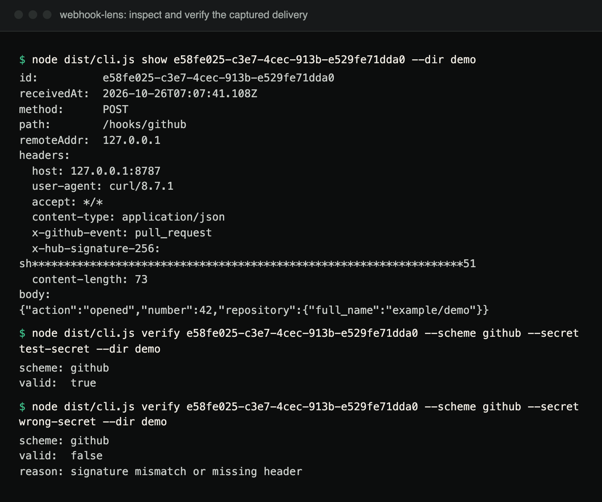
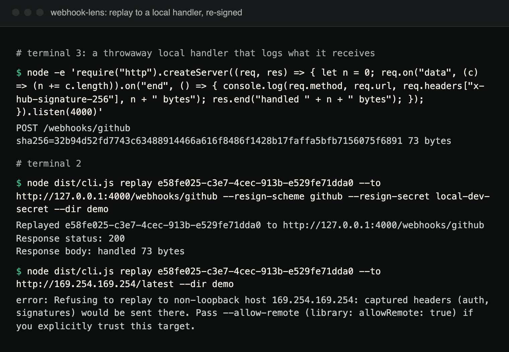

# webhook-lens

Capture, inspect, and replay inbound webhooks locally, verifying provider
HMAC signatures before you trust a payload.

## What

`webhook-lens` runs a small HTTP server on your machine. Point a webhook
provider (or a `curl`/test client) at it, and it will:

- capture every request byte-for-byte (method, path, headers, raw body),
- persist it to disk as JSON so you can inspect it later,
- verify the provider's HMAC signature against a secret you supply, and
- replay any captured delivery against your real handler, as many times as
  you want, optionally re-signed with a different secret.

## Demo

A real end-to-end run on the current code, using synthetic payloads and the
throwaway secrets `test-secret` and `local-dev-secret`. It runs from the
cloned repository after `npm ci && npm run build`, with `--dir demo` so the
captures land in `./demo` instead of the default `.webhook-lens/deliveries`.



*Terminal capture: start the receiver, send a signed delivery with curl, list it.*



*Terminal capture: inspect the captured headers and body (signature redacted), then verify it with the right and a wrong secret.*



*Terminal capture: replay the delivery to a local handler, re-signed with a different secret, and the refusal of a non-loopback target.*

The same session as text:

```bash
# terminal 1
node dist/cli.js listen --port 8787 --dir demo

# terminal 2
BODY='{"action":"opened","number":42,"repository":{"full_name":"example/demo"}}'
SIG="sha256=$(printf '%s' "$BODY" | openssl dgst -sha256 -hmac test-secret | sed 's/^.* //')"
curl -s -X POST http://127.0.0.1:8787/hooks/github -H 'content-type: application/json' \
  -H 'x-github-event: pull_request' -H "x-hub-signature-256: $SIG" --data-binary "$BODY"
# {"status":"captured","id":"e58fe025-c3e7-4cec-913b-e529fe71dda0"}

node dist/cli.js list --dir demo
node dist/cli.js show e58fe025-c3e7-4cec-913b-e529fe71dda0 --dir demo
node dist/cli.js verify e58fe025-c3e7-4cec-913b-e529fe71dda0 --scheme github --secret test-secret --dir demo    # valid: true, exit 0
node dist/cli.js verify e58fe025-c3e7-4cec-913b-e529fe71dda0 --scheme github --secret wrong-secret --dir demo   # valid: false, exit 1

# terminal 3: a throwaway handler to replay into
node -e 'require("http").createServer((req, res) => { let n = 0; req.on("data", (c) => (n += c.length)).on("end", () => { console.log(req.method, req.url, req.headers["x-hub-signature-256"], n + " bytes"); res.end("handled " + n + " bytes"); }); }).listen(4000)'

# terminal 2
node dist/cli.js replay e58fe025-c3e7-4cec-913b-e529fe71dda0 --to http://127.0.0.1:4000/webhooks/github \
  --resign-scheme github --resign-secret local-dev-secret --dir demo
```

The id is generated per capture, so substitute the one `curl` prints. The
signature the handler logs is `HMAC-SHA256(local-dev-secret, body)`, which you
can confirm with the same `openssl` pipeline.

## Why

Debugging a webhook integration usually means one of two unpleasant options:
push to production and read logs, or route the payload through a hosted
tunnel that now sees every request you receive. `webhook-lens` runs entirely
on your machine: nothing leaves it. It also gets the fiddly part right:
verifying a provider's signature over the *exact bytes it sent*, not a
JSON-parsed-and-re-serialized approximation of them, which is where most
homegrown verification scripts quietly break.

## Features

- **Local receiver**: an HTTP server (`node:http`) that captures method,
  path, headers, and the raw request body. Bodies over 10 MB get a `413`.
- **Signature verification** for five schemes, each implemented from its
  provider's documented algorithm and compared with `crypto.timingSafeEqual`:
  - GitHub (`X-Hub-Signature-256`)
  - Stripe (`Stripe-Signature`, with replay-window checking)
  - Shopify (`X-Shopify-Hmac-Sha256`)
  - Slack (`X-Slack-Signature`)
  - A generic, configurable HMAC scheme for anything else
- **Storage**: every capture is written to disk as a standalone JSON file,
  listable and inspectable later.
- **Replay**: re-send a captured delivery to a local target URL
  (`localhost`, `127.0.0.0/8`, `[::1]`; other hosts only with an explicit
  `--allow-remote`), with the original raw body and headers preserved,
  optionally re-signed with your own secret.
- **Redaction**: signatures, auth headers, other secret-looking headers,
  and secret-looking query parameters are masked in CLI output by default.

## Architecture

```
src/
  cli.ts              listen / list / show / replay / verify commands
  args.ts             strict flag parsing (--port, --tolerance, ...)
  server.ts           HTTP receiver: reads raw request bytes, never parses them
  storage.ts          filesystem delivery store, one JSON file per capture
  replay.ts           re-sends a stored delivery, optionally re-signed; loopback check
  redact.ts           header, path and query-string redaction for CLI output
  types.ts            shared types (Delivery, VerifyOptions, ...)
  index.ts            library entry point (re-exports the modules above)
  signatures/
    index.ts          verifyDelivery(): dispatches a Delivery to the right scheme
    github.ts         X-Hub-Signature-256 (HMAC-SHA256, hex, "sha256=" prefix)
    stripe.ts         Stripe-Signature (HMAC-SHA256, hex, t=/v1=, replay window)
    shopify.ts        X-Shopify-Hmac-Sha256 (HMAC-SHA256, base64)
    slack.ts          X-Slack-Signature (HMAC-SHA256, hex, "v0:ts:body" basestring)
    generic.ts        configurable HMAC (any header, algorithm, encoding, prefix)
    util.ts           constant-time comparison helpers
```

### Design point: the raw body is never re-serialized

Every provider signature here is computed over the *exact bytes* the
provider sent, not over `JSON.stringify(JSON.parse(body))`. Those two are
not the same thing: key order, whitespace, numeric formatting, and unicode
escaping can all change silently when a body is parsed and re-serialized,
which changes the bytes and breaks any signature computed over them.

`webhook-lens` never parses the body before storing or verifying it. The
HTTP receiver (`src/server.ts`) accumulates the raw `Buffer` chunks straight
off the socket and stores that buffer, base64-encoded, in the `Delivery`
record's `bodyBase64` field. Replay (`src/replay.ts`) decodes that same
base64 field back into the original bytes and sends them unmodified.
`test/raw-body.test.ts` demonstrates this concretely: it signs a body with
unusual formatting, shows that `JSON.parse` + `JSON.stringify` produces
different bytes, and confirms verification against those re-serialized bytes
fails while verification against the stored raw bytes succeeds.

## Supported providers

| Provider | Header(s)                                          | Algorithm         | Encoding | Notes                          |
|----------|-----------------------------------------------------|--------------------|----------|----------------------------------|
| GitHub   | `X-Hub-Signature-256`                                | HMAC-SHA256        | hex      | `sha256=` prefix                |
| Stripe   | `Stripe-Signature`                                    | HMAC-SHA256        | hex      | `t=...,v1=...`; replay window   |
| Shopify  | `X-Shopify-Hmac-Sha256`                              | HMAC-SHA256        | base64   | no prefix                       |
| Slack    | `X-Slack-Signature`, `X-Slack-Request-Timestamp`      | HMAC-SHA256        | hex      | `v0:` prefix, `v0:ts:body` basestring; optional replay window |
| Generic  | any (configurable)                                   | any (configurable) | hex/base64 | optional configurable prefix  |

## Installation

```bash
git clone https://github.com/hellpuffyt/webhook-lens.git
cd webhook-lens
npm ci
npm run build
npm link   # optional: makes `webhook-lens` available globally
```

webhook-lens is not published to npm; without `npm link`, run the CLI as
`node dist/cli.js <command>`. The library import below resolves once the clone
is linked (`npm link webhook-lens` in your project).

Requires Node.js 20 or newer.

## Usage

```
webhook-lens listen [--port <n>] [--host <host>] [--dir <path>]
webhook-lens list [--dir <path>]
webhook-lens show <id> [--dir <path>] [--raw]
webhook-lens replay <id> --to <url> [--resign-scheme <scheme> --resign-secret <secret>] [--allow-remote] [--dir <path>]
webhook-lens verify <id> --scheme <scheme> --secret <secret> [--tolerance <seconds>] [--dir <path>]
                        [--header <name> --prefix <p> --encoding <hex|base64>]  (generic scheme only)
```

Schemes: `github`, `stripe`, `shopify`, `slack`, `generic`.

Deliveries are stored under `.webhook-lens/deliveries` in the current
working directory by default; pass `--dir` to use a different location.

## Examples

Start the receiver:

```bash
webhook-lens listen --port 8787
```

Point your provider's webhook URL (or a test client) at
`http://localhost:8787/<any-path>`. Each request is captured and printed as
it arrives.

List captured deliveries:

```bash
webhook-lens list
```

Inspect one:

```bash
webhook-lens show 8f9298fe-5a47-4b40-bb03-b0c8cf65bddb
```

Verify a GitHub delivery's signature:

```bash
webhook-lens verify 8f9298fe-5a47-4b40-bb03-b0c8cf65bddb \
  --scheme github --secret "$GITHUB_WEBHOOK_SECRET"
```

Verify a Stripe delivery, allowing a wider replay window (e.g. for an old
capture you're replaying much later):

```bash
webhook-lens verify 8f9298fe-5a47-4b40-bb03-b0c8cf65bddb \
  --scheme stripe --secret "$STRIPE_WEBHOOK_SECRET" --tolerance 999999999
```

Replay a captured delivery against your local dev server, re-signed with
your local secret:

```bash
webhook-lens replay 8f9298fe-5a47-4b40-bb03-b0c8cf65bddb \
  --to http://localhost:3000/webhooks/github \
  --resign-scheme github --resign-secret "$LOCAL_DEV_SECRET"
```

Verify against the generic scheme (e.g. a provider not listed above that
signs with `X-Signature: sha256=<hex hmac>`):

```bash
webhook-lens verify <id> --scheme generic --secret "$SECRET" \
  --header x-signature --prefix "sha256=" --encoding hex
```

### Using the library directly

```ts
import { verifyDelivery, DeliveryStore } from 'webhook-lens';

const store = new DeliveryStore();
const delivery = await store.get('some-id');

const result = verifyDelivery(delivery!, {
  scheme: 'github',
  secret: process.env.GITHUB_WEBHOOK_SECRET!,
});

if (!result.valid) {
  throw new Error(`Invalid signature: ${result.reason}`);
}
```

## Testing

```bash
npm test            # vitest, 110 tests
npm run typecheck   # tsc --noEmit
npm run lint        # eslint . --ext .ts
npm run build       # emits dist/
```

CI runs the tests on Node 20 and 22 on Ubuntu, Windows and macOS, a lint,
type-check and build job, and a smoke test that starts the built receiver,
posts a signed delivery, and checks that `verify` passes with the right
secret, fails with a wrong one, refuses a non-loopback replay target, and
rejects a malformed `--tolerance`.

The test suite covers, among other things: valid and invalid signatures for
every scheme, tampered-body detection, Stripe replay-window expiry, raw-body
preservation against JSON re-serialization, delivery storage round-trips,
and the HTTP receiver exercised against a real server on an ephemeral port.

## Security

- Signature comparisons always use `crypto.timingSafeEqual`, never `===` on
  strings or encoded values, to avoid timing side channels.
- Malformed signature encodings (non-hex, non-base64) are rejected rather
  than throwing or silently truncating.
- Stripe (and, optionally, Slack) verification enforces a replay-window
  check against the signed timestamp.
- Sensitive header values (`Authorization`, provider signature headers,
  cookies, any header whose name contains `signature`, `secret`, `token`,
  `api-key`, `auth`, ...) and secret-looking query parameters
  (`?token=`, `?sig=`, ...) are redacted in CLI output and in the `listen`
  log by default; pass `--raw` to `show` if you explicitly need to see them.
- Capture files are stored unredacted (verification and replay need the
  exact bytes), so they are written owner-only (`0600`, directory `0700`).
  Treat the deliveries directory as secret material.
- Delivery ids are restricted to `[A-Za-z0-9_-]`, so a crafted id cannot
  read, write, or delete files outside the deliveries directory.
- Replay only targets loopback hosts (`localhost`, `127.0.0.0/8`, `[::1]`)
  unless you pass `--allow-remote`, because it forwards the captured
  headers (including `Authorization` and signatures). Only `http`/`https`
  targets are accepted, and URLs with embedded credentials are refused.
- Numeric flags (`--port`, `--tolerance`) are parsed strictly; a malformed
  `--tolerance` is an error rather than a silently disabled replay window.
- The receiver binds to `127.0.0.1` by default; it is meant for local use,
  not as an internet-facing endpoint. Binding another host prints a warning.
  There is no authentication, rate limiting, or disk quota on the receiver.
- Secrets passed as `--secret` / `--resign-secret` are command-line
  arguments: referencing an environment variable (`--secret "$VAR"`, as in
  the examples) keeps the value out of shell history, but it is still
  visible in the process list while the command runs.
- No captured secret or delivery ever leaves your machine; there is no
  telemetry and no external network calls other than the ones you
  explicitly trigger with `replay`.

If you find a security issue, please report it privately as described in
[SECURITY.md](SECURITY.md) rather than in a public issue.

## Contributing

See [CONTRIBUTING.md](CONTRIBUTING.md).

## License

MIT © 2026 Prabesh Sharma. See [LICENSE](LICENSE).
